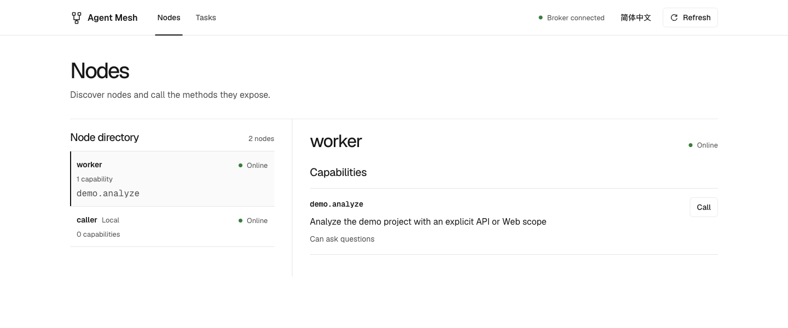
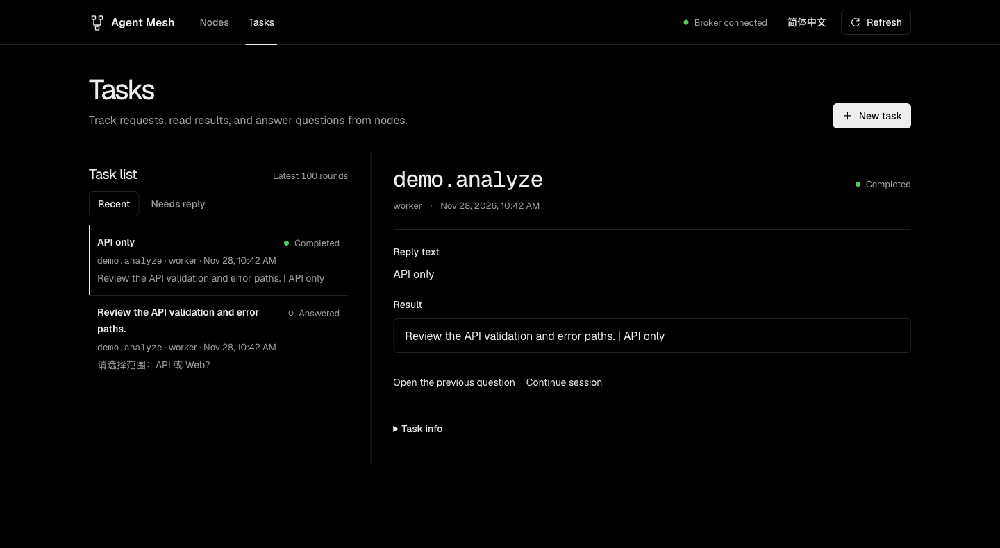

# Agent Mesh

**English** · [简体中文](README.zh-CN.md)

Ask an agent on another machine to do work, answer its follow-up questions, and retrieve the result after a disconnect. Agent Mesh connects private agents through an MQTT 5 broker. Each host makes one outbound connection and keeps its own job history in SQLite. The CLI, six MCP tools, and an on-demand browser workbench use the same local daemon over a Unix socket.

For example, a laptop assistant can discover an agent with access to the orders repository on a VM, request a read-only analysis, and answer “API only” in the original session. The VM owner configures the available methods, working directory and runtime permissions.

## How a call works

```text
Local workbench, CLI, or MCP bridge
       │ Unix socket
  caller daemon → MQTT 5 broker → worker daemon → local runtime
       │                                │
     SQLite                           SQLite
```

Each invocation gets a `job_id`. A multi-turn method also returns a `session_id`. A worker can finish a round with a question and release its execution slot while you decide. Answering creates a new job in the same session. Discovery and status use retained MQTT messages; requests and replies expire. SQLite lets either daemon recover the last confirmed state independently of the terminal.

## Try two nodes locally

You need macOS or Linux, Python 3.11+, [uv](https://docs.astral.sh/uv/) and [Mosquitto](https://mosquitto.org/download/) with its password utility. The demo starts an Echo worker so you can try a full conversation without a model account. On macOS, install the broker with `brew install mosquitto`. On Ubuntu, use `sudo apt install mosquitto mosquitto-clients`. The demo listens on `127.0.0.1:18883` by default.

```sh
git clone https://github.com/UllrAI/AgentMesh.git
cd AgentMesh
uv sync --locked
uv run python examples/local/setup.py "$HOME/.agent-mesh/demo"
```

In three terminals, from the checkout, run one of these commands per terminal. The setup script generates fresh credentials, a one-way caller-to-worker ACL, and a broker configuration bound to loopback.

```sh
# Terminal 1
mosquitto -c "$HOME/.agent-mesh/demo/mosquitto.conf"

# Terminal 2
. "$HOME/.agent-mesh/demo/env"
uv run agent-mesh serve --config "$HOME/.agent-mesh/demo/worker.yaml"

# Terminal 3
. "$HOME/.agent-mesh/demo/env"
uv run agent-mesh serve --config "$HOME/.agent-mesh/demo/caller.yaml"
```

On Linux distributions that restrict the Mosquitto service to system configuration paths, use the [container command](docs/deployment.md#local-demo-on-linux-with-apparmor) for Terminal 1.

## Open the local workbench



The workbench opens on the node view. See which nodes the caller has discovered, check their online status, and read what their methods do. Choose a method on the target node to send a request.

With the demo caller daemon running, use a fourth terminal on the same machine.

```sh
uv run agent-mesh ui --socket "$HOME/.agent-mesh/demo/caller.sock"
```

Open the task view to find an earlier request, read its result, or answer a clarifying question. If two jobs have the same question, use the request previews to find the right one. You can switch between views while your tasks continue to run.



The command opens the browser by default. Use `--no-open` to print the link and open it yourself. The interface uses English or Chinese based on your browser language and follows your system’s light or dark appearance. Press Ctrl+C in the workbench terminal to stop its page server. The caller daemon and accepted tasks continue running. [Workbench access details](docs/deployment.md#local-workbench)

## Use the CLI

In a separate terminal, list the nodes and call the worker. It asks which part of the project to analyze. The CLI prints an answer command containing the question's actual job ID.

```sh
export AGENT_MESH_SOCKET="$HOME/.agent-mesh/demo/caller.sock"
uv run agent-mesh list
uv run agent-mesh call worker demo.analyze --prompt 'Analyze the module boundaries' --wait
# Replace QUESTION_JOB_ID with the value printed above.
uv run agent-mesh answer 'QUESTION_JOB_ID' --text 'API only' --wait
uv run agent-mesh jobs
```

To skip the clarification, provide the scope in the first request.

```sh
uv run agent-mesh call worker demo.analyze --params '{"prompt":"Analyze the module boundaries","scope":"API"}' --wait
```

### Find a task again

`jobs` reads recent outbound tasks from the caller's local database, including when offline. Use `job JOB_ID` to see the current snapshot and the latest confirmed answer. A `needs_input` result carries a question and deadline. A `succeeded` result carries the output. For an independent follow-up in the same conversation, call the original target and method with `--session SESSION_ID`. Interactive calls wait up to 30 seconds by default. Use `--async` to return immediately or `--wait` in a script.

## Connect an MCP client

With the caller daemon running, register its stdio bridge. Run these commands from the checkout so the executable path is absolute.

```sh
codex mcp add agent-mesh -- "$PWD/.venv/bin/agent-mesh" mcp --socket "$HOME/.agent-mesh/demo/caller.sock"
claude mcp add agent-mesh -- "$PWD/.venv/bin/agent-mesh" mcp --socket "$HOME/.agent-mesh/demo/caller.sock"
```

The bridge exposes `mesh_list`, `mesh_inspect`, `mesh_invoke`, `mesh_answer`, `mesh_job_status` and `mesh_jobs`. An asynchronous submit returns a job ID. The host can use a bounded wait on that ID and deliver the result or question in the originating conversation. To install the CLI independently of the checkout, run `uv tool install git+https://github.com/UllrAI/AgentMesh.git`.

## Use a real worker

The target owner chooses which methods to expose and their working directory, concurrency, execution timeout and permissions. Adapters support Codex, Claude Code and fixed local commands. The fixed-command adapter accepts a JSON request on stdin and can integrate another runtime with a known execution interface. The [deployment guide](docs/deployment.md) includes a complete worker configuration, a tested Codex profile, the handler contract and service setup.

Use a different broker account, socket and database for each agent. The example ACL grants `caller → worker`; this grant covers every method the worker exposes. Put methods with different caller permissions on separate logical agents. The broker can read the messages it forwards. Use TLS with certificate verification over public networks.

## Development and verification

```sh
uv sync --locked
uv run pytest -q
uv build
```

Install Mosquitto and its password utility to run the real-broker tests. The suite covers dropped replies, retained-message filtering, duplicate delivery, concurrent answers and killing a worker daemon mid-job. Live Codex checks and Claude Code checks with a scripted model backend are documented separately.

## Documentation

- [Deployment and runtime adapters](docs/deployment.md)
- [Protocol v1.3 and design rationale (中文)](docs/spec/v1.3.md)
- [Acceptance coverage and test commands](docs/acceptance.md)

The implementation uses Python, SQLite, Eclipse Paho via aiomqtt, and the official MCP Python SDK. The package version and the wire protocol version are independent.

Copyright 2026 UllrAI. [Apache License 2.0](LICENSE).
