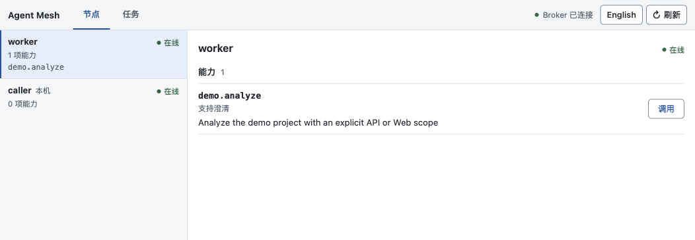

# Agent Mesh

[English](README.md) · **简体中文**

Agent Mesh 让本地助手发现并调用其他机器上的私有 Agent。你可以把代码分析委派给有仓库权限的节点，在原会话中回答它提出的问题，断线后再找回任务和结果。目标机器的管理员配置开放的方法、工作目录和运行权限。

例如，笔记本上的助手可以请虚拟机里的 Agent 分析订单服务的模块边界。目标询问要分析 API 还是 Web 时，你可以只回答「API only」。目标会从原会话继续，沿用首轮已经给出的任务背景。

## 两节点如何协作

```text
本地工作台、CLI 或 MCP 桥
        │ Unix Socket
    调用方 Daemon ── MQTT 5 Broker ── 执行方 Daemon ── Runtime Adapter
        │                                │
   本地 SQLite                        本地 SQLite
```

两台机器的 Daemon 都主动连到 Broker。Broker 按 ACL 转发发现信息、请求和回复，执行方 Daemon 在本机启动配置好的 Runtime。需要澄清时，执行方结束当前轮次并释放执行槽，收到答复后再继续会话。两个节点分别把任务记录保存在自己的 SQLite 数据库。CLI、MCP 和按需启动的浏览器工作台通过同一个本地 Unix Socket 访问任务记录。

## 本地启动两个节点

需要 macOS 或 Linux、Python 3.11 或更新版本、Git、uv 和 Mosquitto（包含 `mosquitto_passwd`）。示例用 Echo 执行任务，无需模型账号。[uv 安装指南](https://docs.astral.sh/uv/getting-started/installation/)

macOS 可以用 `brew install mosquitto` 安装 Broker，Ubuntu 可以用 `sudo apt install mosquitto mosquitto-clients`。[Mosquitto 安装说明](https://mosquitto.org/download/) · [Ubuntu 软件包](https://packages.ubuntu.com/search?keywords=mosquitto)

```sh
git clone https://github.com/UllrAI/AgentMesh.git
cd AgentMesh
uv sync --locked
uv run python examples/local/setup.py "$HOME/.agent-mesh/demo"
```

初始化脚本要求目标目录尚不存在。它会生成两个独立的 Broker 凭据、只允许 `caller` 调用 `worker` 的 ACL，以及监听 `127.0.0.1:18883` 的 Broker 配置。端口已占用时，可以在初始化命令末尾加 `--port 18884`。

在仓库目录开四个终端。前三个分别运行 Broker、执行方和调用方，在第四个发起调用。

```sh
# 终端 1
mosquitto -c "$HOME/.agent-mesh/demo/mosquitto.conf"

# 终端 2
. "$HOME/.agent-mesh/demo/env"
uv run agent-mesh serve --config "$HOME/.agent-mesh/demo/worker.yaml"

# 终端 3
. "$HOME/.agent-mesh/demo/env"
uv run agent-mesh serve --config "$HOME/.agent-mesh/demo/caller.yaml"
```

如果 Linux 发行版限制 Mosquitto 只能读取系统配置路径，终端 1 可使用[容器启动命令](docs/deployment.md#local-demo-on-linux-with-apparmor)。

## 打开本地工作台



工作台默认打开节点页。你可以查看已发现的节点、在线状态以及每个方法能做什么。选中目标节点公开的方法，即可发起调用。

启动示例的 `caller` Daemon 后，在同一台机器的第四个终端运行以下命令。

```sh
uv run agent-mesh ui --socket "$HOME/.agent-mesh/demo/caller.sock"
```

打开任务页可以找回此前发出的请求、查看结果或回答澄清问题。如果两项任务收到了相同的问题，可以用请求摘要辨认。你可以在两个页面之间切换，任务会照常继续。

命令默认打开浏览器。加 `--no-open` 时，命令会打印链接供你手动打开。界面按浏览器语言显示中文或英文，明暗外观跟随系统。在工作台所在终端按 Ctrl+C 关闭页面服务，调用方 Daemon 和已接受的任务会继续运行。[工作台访问说明](docs/deployment.md#local-workbench)

## 使用 CLI

在另一个终端先确认 `worker` 在线，再发起分析。没有指定范围时，Echo 会问要分析 API 还是 Web。交互式 CLI 会显示带实际任务 ID 的答复命令。

```sh
export AGENT_MESH_SOCKET="$HOME/.agent-mesh/demo/caller.sock"
uv run agent-mesh list
uv run agent-mesh call worker demo.analyze --prompt 'Analyze the module boundaries' --wait
```

可以直接使用 CLI 打印的命令，也可以把输出中提问轮的 `job_id` 填入以下变量。

```sh
QUESTION_JOB_ID='替换为提问轮的 job_id'
uv run agent-mesh answer "$QUESTION_JOB_ID" --text 'API only' --wait
uv run agent-mesh jobs
```

如果首轮已经确定范围，在参数里给出 `scope` 即可直接取得结果。

```sh
uv run agent-mesh call worker demo.analyze --params '{"prompt":"Analyze the module boundaries","scope":"API"}' --wait
```

也可以独立安装 CLI，无需保留仓库目录。

```sh
uv tool install git+https://github.com/UllrAI/AgentMesh.git
```

## 查找任务和续接会话

- **`job_id` 标识一次提交。** 首轮提出的澄清问题使用该轮的 ID。用它执行 `answer` 后，答复会得到新的 `job_id`。查看答复轮的结果时，使用新 ID。查询原提问轮也能看到答复进展。
- **`session_id` 标识可续接会话。** 在同一会话中作普通追问时，使用 `call --session` 并带上新一轮参数。回答待答问题时，`answer` 会根据提问轮查出所属会话，只需提交答复正文。
- **等待结束后可以继续查同一任务。** `call` 和 `answer` 在交互式终端默认等待结果或澄清，等待阶段最多 30 秒。脚本和 MCP 默认异步。CLI 可用 `--wait` 或 `--async` 显式选择。已接受的任务会在目标上继续运行，关闭终端或断开调用方连接不会取消它。

重新打开终端后，连回同一个调用方 Daemon，先用 `jobs` 找到原任务，再用 `job` 查看状态和问题。离线时也能读取本地任务列表，联网后可按指定 ID 查询远端状态。

```sh
export AGENT_MESH_SOCKET="$HOME/.agent-mesh/demo/caller.sock"
uv run agent-mesh jobs
JOB_ID='替换为要查看的 job_id'
uv run agent-mesh job "$JOB_ID"
# 如果要等这一轮结束，使用有界等待。
uv run agent-mesh job "$JOB_ID" --wait-timeout-s 50
```

普通追问沿用结果中给出的会话 ID。

```sh
SESSION_ID='替换为上一轮的 session_id'
uv run agent-mesh call worker demo.analyze --session "$SESSION_ID" --prompt 'Which module owns the API routes?' --wait
```

## 接入 MCP 客户端

启动 `caller` Daemon 后，从仓库目录运行与你的客户端对应的命令。这样注册时使用的是桥接程序的绝对路径。

```sh
codex mcp add agent-mesh -- "$PWD/.venv/bin/agent-mesh" mcp --socket "$HOME/.agent-mesh/demo/caller.sock"
claude mcp add agent-mesh -- "$PWD/.venv/bin/agent-mesh" mcp --socket "$HOME/.agent-mesh/demo/caller.sock"
```

| MCP 工具 | CLI | 用途 |
| --- | --- | --- |
| `mesh_list` | `list` | 列出节点、在线状态和能力，可按方法筛选 |
| `mesh_inspect` | `inspect <agent>` | 查看目标节点公开的方法、输入约定和会话能力 |
| `mesh_invoke` | `call` | 发起任务，或用 `session_id` 在原会话中追问 |
| `mesh_answer` | `answer` | 根据提问轮的 `job_id` 提交答复 |
| `mesh_job_status` | `job` | 查看指定轮的状态、结果或澄清进展 |
| `mesh_jobs` | `jobs` | 查看最近的本地出站任务，找回先前提交的轮次 |

调用 `mesh_invoke` 或 `mesh_answer` 后，用返回的 `job_id` 调用 `mesh_job_status`。等待结果时，`wait_timeout_s` 应短于宿主的工具时限，例如宿主允许 60 秒时设为 50 秒。收到 `needs_input` 后，在发起委派的原对话中转达问题，再用该提问轮的 ID 作答。无交互的宿主需要预先授权其调用 `mesh_invoke` 和 `mesh_answer`。按客户端的工具权限设置授予有权委派的调用方。

## 部署权限和运行器

- 每个 Agent 使用独立的 Broker 凭据、本地 Socket 和数据库。Broker ACL 按节点授予发起调用、接收回复和发现能力的权限。对某个目标节点的调用授权覆盖该节点开放的所有方法。读写权限需要分开授权时，部署成不同 Agent ID。
- 目标 Daemon 从本地配置选择方法、工作目录和权限，调用方只提交方法参数或答复。工作目录决定任务从哪里启动，文件访问范围由 Runtime 权限配置或宿主隔离限制。Broker 的密码环境变量由 Daemon 使用，不转交 Runtime。
- 跨机器部署时，为各节点配置可达的 Broker 地址。通过公网访问时使用 `mqtts://` 和匹配 Broker 主机名的证书。Broker 可以读取它转发的消息。部署前用服务实际运行的账号验证项目读写边界和已启用的工具。[部署指南](docs/deployment.md)

| 运行器 | 配置和用途 |
| --- | --- |
| Echo | `type: echo`，用于体验协议和会话，示例会记住首轮输入并询问缺失的范围 |
| Codex | `type: codex`，使用专用 `codex_home` 和本地命名权限配置，通过线程 ID 续接非交互进程 |
| Claude Code | `type: claude`，用本地 settings JSON 设置方法权限，从结构化事件取得结果并按会话 ID 续接 |
| 固定命令或自研 Agent | `type: command`，本地配置固定参数数组，从 stdin 接收 JSON，向 stdout 输出结果或问题。处理程序负责保存自己的会话 |

方法可声明 `single_turn`（独立单轮）、`session`（可续接）或 `clarify`（可续接并提出澄清问题）。协议版本与 Python 包版本各自维护。[协议 v1.3 与设计说明](docs/spec/v1.3.md)

## 测试

装好依赖和 Mosquitto 后，在仓库目录运行以下命令。

```sh
uv sync --locked
uv run pytest -q
uv build
```

自动化测试使用临时数据库和 Broker 凭据，覆盖 CLI、MCP、SQLite、ACL、多轮交互和崩溃恢复。模型宿主的手工验证需要在执行机器上配置相应运行环境。[验收记录](docs/acceptance.md)

实现使用 Python 和 SQLite，通过 aiomqtt 使用 Eclipse Paho，并通过官方 MCP Python SDK 提供工具。

版权 © 2026 UllrAI。采用 [Apache License 2.0](LICENSE)。
