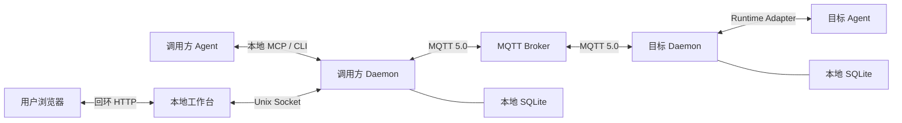
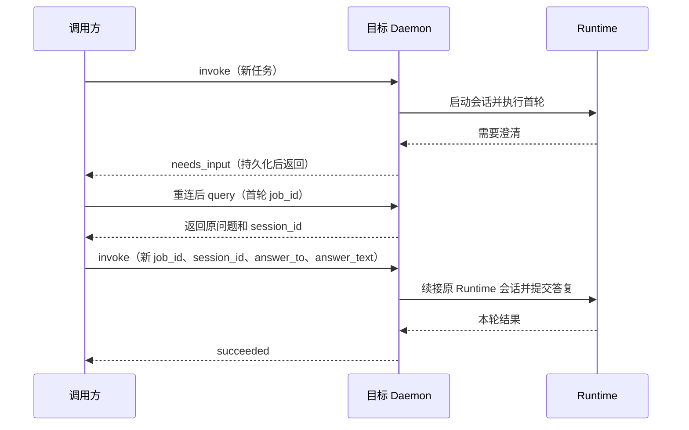

# Agent Mesh v1.3（MVP）— 私有 Agent 互发现、调用与多轮交互

> 日期 2026-11-27 · MQTT 5.0 + UTF-8 JSON
>
> 面向用户授权的少量私有 Agent。本文定义 v1.3 协议。当前实现的实测范围见[验收记录](../acceptance.md)。

## 1. 目标与架构

- 支持 Muse VM、Mac Codex、Claude Code 和自研 Agent 跨机器发现、调用、追问和澄清。
- Agent 主动出站连接 MQTT Broker。Agent 宿主无须对外开放入站端口，接入优先复用 CLI、MCP、SDK 或 API。
- Broker 是唯一需要集中部署的组件，负责认证、Topic ACL、保留消息与转发。会话、调用状态和执行均由各节点本地管理。
- MVP 暂缓公网发现、联邦、多租户、端到端加密、离线任务队列、远程审批与取消、自动协作编排及 A2A 兼容。



一个逻辑 Agent 默认对应一个 Daemon 实例、一份配置和一条 MQTT 连接。同机运行多个 Agent 时使用不同的 Agent ID、Socket 和 SQLite 文件。自研常驻 Agent 可以直接内嵌 Mesh Core。小规模部署以 Mosquitto 为默认，也可沿用已有 EMQX 或 Apache BifroMQ，按 Broker 验证 ACL、会话和保留消息配置。

## 2. 本地接入

### 2.1 CLI 和 MCP

CLI 与 MCP 共用本地 Daemon。默认 Socket 为 `~/.agent-mesh/agent.sock`，放在用户私有目录，权限为 `0600`。寻址优先级依次为 `--socket`、`AGENT_MESH_SOCKET`、`--config` 指定的配置、默认路径。

| CLI | MCP | 行为 |
|---|---|---|
| `agent-mesh serve --config <path>` | `agent-mesh mcp` 启动 stdio 桥 | Daemon 持有 MQTT 连接，MCP 通过 Socket 转发工具调用 |
| `agent-mesh list` | `mesh_list(method?)` | 列出 Agent、在线状态和能力。本地响应同时给出观察节点 `local_id` 和它的 Broker 连接状态 `broker_connected` |
| `agent-mesh inspect <agent>` | `mesh_inspect(agent_id)` | 查看 Agent Card |
| `agent-mesh call <agent> <method> --prompt <text>` | `mesh_invoke(target, method, params, session_id?, execution_timeout_s?)` | 发起任务或普通追问。CLI 用 `--session` 续接，`--prompt` 构造仅含 `prompt` 的参数对象，其他方法可用 `--params '<JSON 对象>'` |
| `agent-mesh answer <提问轮 job_id> --text <答复>` | `mesh_answer(job_id, text)` | Daemon 根据提问轮记录取得目标、方法和会话，提交答复并返回答复轮的 `job_id` |
| `agent-mesh jobs` | `mesh_jobs(limit?)` | 按提交时间倒序列出本地出站任务，默认最近 20 轮，可用 `--limit` 调整。每项含任务 ID、目标、方法、提交时间和最近状态 |
| `agent-mesh job <job_id>` | `mesh_job_status(job_id, wait_timeout_s?)` | 查看指定轮的快照及其澄清答复进展（§5.2）。在线时按需查询仍未取得终态的轮次 |

`call` 和 `answer` 在交互式终端默认等待本轮结果，收到终态（含澄清问题）或明确提交错误即返回。等待最多 30 秒，到时输出 `job_id` 和最近状态，远端任务继续执行。脚本环境和 MCP 默认异步，返回 `job_id` 及最近状态。CLI 可用 `--wait` 或 `--async` 显式选择。

MCP 的状态工具说明应告诉调用方：用户在等结果或澄清时，用刚才提交得到的 `job_id` 调用 `mesh_job_status`，可以指定一个短于宿主工具调用时限的 `wait_timeout_s`。省略或传 0 时按常规查询，不等待执行结束。正值表示在调用方 Daemon 本地最多等待这么多秒。已有终态、明确提交错误或处于断线状态时直接返回；等待途中出现任一情况时提前返回。到时仍返回同一 ID 和最近状态，可继续查询。等待复用已有回复和按需 `query`，无需周期性向 Broker 轮询。宿主结束工具调用时也结束本次等待，远端执行按原时限继续。

调用方拿到 `needs_input` 时，先依据原请求已给出的范围作答；选择仍不明确且会改变结果时，把问题带回发起委派的对话。问题待答时，CLI 显示问题、答复截止时间及可直接填写的 `answer` 命令。MCP 返回相同的问题、截止时间和提问轮 `job_id`。关闭终端或丢失上下文后，先用 `jobs` 找回任务，再用 `job` 查详情。本地列表在断网时也可用，读取列表不会批量查询远端。

```bash
codex mcp add agent-mesh -- agent-mesh mcp
claude mcp add agent-mesh -- agent-mesh mcp --socket ~/.agent-mesh/claude-mac.sock
```

### 2.2 Runtime Adapter

收到远程调用时，目标 Daemon 通过 Adapter 启动专用 Runtime 任务。支持多轮的方法在首次调用时建立由 Mesh 管理的 Runtime 会话，后续轮次显式按记录的 Runtime 会话 ID 续接。

| Runtime | MVP 接入 |
|---|---|
| Codex | 用 `codex exec --json` 执行首轮，从 `thread.started` 事件取 `thread_id`。续接用 `codex exec --json resume <id> -` 从 stdin 读入本轮文本。声明 `clarify` 的方法可在首轮及续接时用 `--output-schema` 约束最终消息 |
| Claude Code | `claude -p --output-format stream-json --verbose` 获取结果和会话 ID，用 `claude -p --resume <id>` 续接 |
| Muse | 复用现有执行 API 或 CLI，先确认可调用入口及会话能力 |
| 自研 Agent 或脚本 | 直接调用本地 handler 或固定命令，按实现声明交互能力 |

Adapter 负责参数映射、Runtime 会话 ID、结构化结果、执行超时和子进程清理。支持澄清的 Adapter 将每轮最终输出解析为结果或结构化问题。问题输出需有明确的类型和文本，普通自然语言输出按普通结果处理。声明多轮能力前，应确认目标 Runtime 保存会话且可按 ID 续接。有会话 ID 后及时写入本地记录，回复由 Mesh 分配的 `session_id`。

例如，Codex Adapter 可约定最终消息为 `{"type":"question","text":"要分析 API 还是 Web？"}` 或 `{"type":"result","text":"…"}`。同一轮可能输出多条 `agent_message`。等 `turn.completed` 和进程成功退出后，从最终消息取结果，分别映射为 `needs_input` 或 `succeeded`。续接进程也可能直接以非零码退出而没有 JSONL 事件，Adapter 须处理该退出路径。声明能力时用服务实际启动的入口验证：首轮遗漏一个会改变结果的选择，退出进程后仅凭会话 ID 和一段答复取得结果；再用范围已给定的输入验证可以直接完成。

- 用参数数组或 stdin 传递 Prompt。禁止拼入 `sh -c`，也禁止让 Prompt 被解析为 CLI 选项。
- CLI 在独立进程组执行。超时或正常停止时向进程组发出 `SIGTERM`，宽限期过后对仍存活的进程发 `SIGKILL`，并确认回收。宿主监督器或本地监护进程负责在 Daemon 崩溃后清理该进程组。API Adapter 依据 Runtime 的接口确认执行是否结束。尚未确认结束的执行继续占用原槽，其他可用槽仍可接单，历史任务仍可查询。
- 默认每个 Agent 一个执行槽，正常执行占满时立即返回 `BUSY`。同一会话始终只有一轮执行。等待澄清不占执行槽。首版不开放入站 Runtime 的自动反向调用，避免执行中的 Agent 互相等待。
- Adapter 增量读取 JSONL 或其他输出，只提取必要字段。发送前检查序列化后的字节数。大文本可截断并标记 `truncated: true`，或返回 `RESULT_TOO_LARGE`。

### 2.3 本地配置示例

```yaml
agent_id: codex-mac
mqtt:
  url: mqtts://mesh.example.com:8883
  username: codex-mac
  password_env: MESH_MQTT_PASSWORD
socket: ~/.agent-mesh/agent.sock
job_store: ~/.agent-mesh/codex-mac.db
runtime:
  type: codex
  workdir: ~/projects/example
  max_concurrent_jobs: 1
  execution_timeout_s: 300
  methods:
    - name: codex.analyze
      description: "只读分析订单服务的 API 和 Web 模块，返回模块边界及对应源码路径"
      permission_profile: mesh-project-read
      interaction: clarify
```

示例为 Daemon 配置，`permission_profile` 指向已配置的 Runtime 权限。仅开放本地配置列出的方法，工作目录和权限都由目标端设置。项目级读取约束由 Runtime 实际文件系统权限或宿主隔离实现，并在首次执行及每轮续接应用当前本地权限。开放方法前，应核对 Runtime 可用的工具、网络和凭据。用于 Broker 登录的凭据仅由 Daemon 读取。

MVP 按目标 Agent 授权。获准调用 `codex-mac` 的节点可以请求它开放的全部方法，包括以后新增的写入方法。如果只有部分调用方可以写入，在同一宿主用独立 Agent ID 和配置发布写入方法，仅向这部分调用方开放该 ID 的调用与回复 Topic。只读节点继续使用上例配置。

参考实现使用 Python 3.11+、aiomqtt / Eclipse Paho、官方 MCP Python SDK、SQLite 和 Unix Socket。先支持 macOS 和 Linux，由 `launchd` 或 `systemd` 管理。Runtime 可执行文件、认证和权限配置以服务实际运行环境为准。

### 2.4 本地浏览器工作台

`agent-mesh ui` 在调用方宿主按需启动页面服务，监听本机回环地址的随机端口。启动链接带有本次服务的临时访问凭据。命令默认打开浏览器，`--no-open` 只打印链接。工作台沿用 §2.1 的 Socket 寻址规则，连接已运行的调用方 Daemon。

工作台默认打开节点页，显示调用方已发现的节点、在线状态及公开的方法和说明。用户可从目标节点的方法直接发起调用。任务页用于找回此前的出站任务、查看指定轮次的状态和结果，或按提问轮的 `job_id` 提交答复。切换视图时，任务按当前状态继续处理。

首页先让人判断「哪个节点能做这件事」。桌面用列表和详情并排呈现，窄屏改为上下排列。界面使用系统字体，方法名等标识使用等宽字体，明暗外观跟随系统。节点状态始终附文字。字体分工与跟随系统明暗的做法参考了 [DeepSeek Harness 的界面主题](https://github.com/deepseek-ai/deepseek-harness/blob/master/packages/client/ui-theme/README.md)。

“待回答”筛选最近 100 轮中的有效问题。调用方连着 Broker 时仍可尝试调用标为离线的目标。发送结果未确认时，可以在任务页查看该轮记录。Daemon 负责本地记录和 MQTT 收发，Broker 按 Topic ACL 转发。界面按浏览器语言选择中文或英文。按 Ctrl+C 停止页面服务后，Daemon 继续处理任务。

## 3. 身份、Topic 与授权

每个 Agent 分配唯一稳定的 `agent_id`（`[a-z0-9][a-z0-9_-]{0,63}`）和独立 MQTT 账号。Broker 将 Client ID 绑定到账号，Mosquitto 可在对应监听器使用 `use_username_as_clientid true`。静态 ACL 由部署者配置。身份从 Topic 和 ACL 得出。

| Topic | 发布方 | 订阅方 | QoS | Retained |
|---|---|---|---:|---|
| `agents/<id>/card` | 自己 | Mesh 成员 | 1 | 是 |
| `agents/<id>/status` | 自己或其 LWT | Mesh 成员 | 1 | 是 |
| `agents/<target>/invoke/<caller>` | 获授权的 caller | target | 1 | 否 |
| `agents/<caller>/replies/<target>` | 获授权的 target | caller | 1 | 否 |

Mosquitto ACL 示例只开放 `muse-vm → codex-mac` 的调用和对应回复。

```conf
user muse-vm
topic read agents/+/card
topic read agents/+/status
topic write agents/muse-vm/card
topic write agents/muse-vm/status
topic read agents/muse-vm/invoke/+
topic read agents/muse-vm/replies/+
topic write agents/codex-mac/invoke/muse-vm

user codex-mac
topic read agents/+/card
topic read agents/+/status
topic write agents/codex-mac/card
topic write agents/codex-mac/status
topic read agents/codex-mac/invoke/+
topic read agents/codex-mac/replies/+
topic write agents/muse-vm/replies/codex-mac
```

Broker 部署在各节点可达的内网、tailnet 或 VPS，关闭匿名访问并启用 retained 持久化。经公网连接必须用 TLS 并校验证书，用户受控的 VPN 或本机连接可按部署选择。Broker 是受信任的内容中转方，可读取消息。

## 4. MQTT 连接与发现

| 参数 | 默认值或约定 |
|---|---|
| Clean Start / Session Expiry Interval | `true` / `0`，断线销毁 MQTT 会话，避免离线调用积压 |
| Keep Alive | 30 秒 |
| LWT | retained `offline`，Will Delay 为 0 |
| 在线状态 | 每 60 秒发布 retained `online`，MQTT Message Expiry 为 180 秒 |
| Card | retained，注册、重连和能力变更时更新，退役时显式清除 |
| 请求与回复 | `invoke` 的消息有效期取首次接收剩余时间且最多 30 秒，`query` 和回复分别为 30 秒、60 秒 |
| 最大应用 Payload | 64 KiB，按序列化后的 UTF-8 JSON 字节数计算。Broker 的 MQTT 包限制需另留 Topic 和报头空间 |

- 启动时打开任务存储，连接 Broker 并配置 LWT，订阅 Card、Status、自己的入站调用和回复。存储可读且订阅成功后即可处理 `query`，发布 Card 和 `online`。`online` 表示节点已连接。Adapter 初始化、恢复执行槽和清理旧执行可同时进行。接收新轮前须已核清可用执行槽、Adapter 就绪且存储可写，否则按 §5.3 返回提交错误。
- 注册和状态订阅接收 retained 初始值。调用和回复订阅使用 `Retain Handling=2`、`Retain As Published=true`，接收端丢弃带 RETAIN 标记的调用与回复。重连时清空发现缓存、重订阅并重新发布注册与状态。
- 本地用收到的 `online` 消息剩余有效期设置单调时钟计时器。Broker 过期后不会通知已有订阅方。存在 Card 且在线状态未过期时显示 `online`，无有效在线状态时显示 `offline`，本地与 Broker 断连时显示 `unknown`。在线状态用于展示，实际调用以目标回复为准。
- 正常停止时发布 `offline` 并保留 Card，便于其他节点查看已登记的离线 Agent。退役时由部署者停止实例、撤销账号权限，再清除该节点的 Card 和 Status retained 消息。
- 断线时本地拒绝新提交。MQTT 客户端不在重连后自动补发旧调用。已接受的任务继续在目标本地执行，恢复后通过 `query` 获取持久化状态或结果。

### 4.1 Agent Card

```json
{
  "spec_version": "1.3",
  "id": "codex-mac",
  "name": "Mac Codex",
  "capabilities": [
    {
      "method": "codex.analyze",
      "description": "只读分析订单服务的 API 和 Web 模块，返回模块边界及对应源码路径",
      "interaction": "clarify",
      "input_schema": {
        "type": "object",
        "properties": {"prompt": {"type": "string"}},
        "required": ["prompt"]
      }
    }
  ]
}
```

Card 必须包含 `spec_version`、`id` 和 `capabilities`。纯调用方的能力列表可以为空。每项能力的 `method` 唯一，`input_schema` 可选，`interaction` 默认为 `single_turn`。Card 的 ID 必须与 Topic 一致。Card 仅发布能力所需的公开描述。

多个节点提供相同方法时，用 `description` 写清可公开的项目或业务范围、适用任务和返回内容，供调用方选择。若不同节点对应不同项目且用户的指代无法消歧，先询问项目。首次委派在 `params` 中带上完成任务所需的项目、范围和已知约束。目标 Runtime 从自己的新会话开始，无法看到调用方此前的对话。

| `interaction` | 能力 |
|---|---|
| `single_turn` | 每次执行为独立任务 |
| `session` | 可在同一会话续接并继续追问 |
| `clarify` | 支持会话续接，执行时也可提出需要调用方回答的问题 |

### 4.2 Status

```json
{"spec_version":"1.3","status":"online"}
```

```json
{"spec_version":"1.3","status":"offline"}
```

## 5. 调用、会话和澄清

同一部署统一使用 `spec_version: "1.3"`，适用于 Card、Status、请求和回复。接收方忽略未知可选字段。

| 标识 | 作用 |
|---|---|
| `job_id` | 调用方为每轮生成的 UUID v4。去重键为 `(caller_id, job_id)`，同一轮重发复用原 ID |
| `session_id` | 目标方为支持多轮的方法生成的 UUID v4，绑定调用方、方法和目标本地 Runtime 会话 |
| `answer_to` | 当前答复针对的提问轮次，值为该轮的 `job_id` |

### 5.1 请求

在 `agents/<target>/invoke/<caller>` 发布，必填 `type` 为 `invoke` 或 `query`。

首轮及后续追问均使用 `invoke`。省略 `session_id` 时，支持多轮的方法创建新会话。

```json
{
  "spec_version": "1.3",
  "type": "invoke",
  "job_id": "550e8400-e29b-41d4-a716-446655440000",
  "method": "codex.analyze",
  "params": {"prompt": "分析项目的模块边界"},
  "expires_at": 1795761330
}
```

普通追问带同一 `session_id` 和 `method`，与首轮一样用 `params` 传方法参数。答复澄清问题时，调用方 Daemon 为答复分配新的 `job_id`，从提问轮补齐 `method`、`session_id` 和 `answer_to`，用 `answer_text` 传答复正文。

```json
{
  "spec_version": "1.3",
  "type": "invoke",
  "job_id": "99d317c5-4917-46f9-9e9e-1eeb7905c3db",
  "method": "codex.analyze",
  "session_id": "91c9d994-9492-4896-8ede-a741ca24bc6a",
  "answer_to": "550e8400-e29b-41d4-a716-446655440000",
  "answer_text": "只分析 API 服务，跳过 Web 前端",
  "expires_at": 1795761500,
  "execution_timeout_s": 300
}
```

- 首轮和普通追问必填 `params`（符合方法约定的 JSON 对象）。澄清答复必填 `answer_to` 和非空字符串 `answer_text`，仅适用于 `clarify` 会话。两种输入互斥，字段混用或缺失返回 `INVALID_REQUEST`。Adapter 将答复作为下一轮用户文本送入原 Runtime 会话。`single_turn` 不接收会话字段。
- `expires_at` 是本轮首次接收截止时间，使用 UTC Unix 秒，默认创建后 30 秒。目标以本地时钟判定，主机使用系统时间同步。过期的首次提交不接收。已接收的同轮重发仍返回原状态。
- `execution_timeout_s` 是可选的执行时限，超过目标本地配置时取目标上限，由接收回执返回生效值。

状态查询只需 `job_id`。目标按认证的调用方查本地记录，查询不会启动任务。

```json
{"spec_version":"1.3","type":"query","job_id":"550e8400-e29b-41d4-a716-446655440000"}
```

### 5.2 回复

在 `agents/<caller>/replies/<target>` 发布。调用方只接受与本地任务登记的目标一致的回复。

| `type` | 内容 | 调用方处理 |
|---|---|---|
| `job` | 目标持久化的任务状态快照 | 按状态更新本地任务 |
| `invoke_error` | 本次提交的错误，如 `BUSY` | 单独记录提交错误，保留已知任务状态 |
| `query_error` | 本次查询的错误，如 `JOB_NOT_FOUND` | 单独记录查询错误，保留已知任务状态 |
| `progress` | 可选提示，尽力投递 | 仅用于当前展示 |

所有回复包含 `spec_version`、`type` 和 `job_id`。`job` 再带 `status`，有会话时带 `session_id`。任务状态如下。

| `status` | 含义 |
|---|---|
| `accepted` | 已持久化接收并占用执行槽，附带生效的 `execution_timeout_s` |
| `succeeded` | 本轮完成，带 `result` |
| `needs_input` | 本轮结束并释放执行槽，带 `question.text` 和 `question.expires_at`，等待新一轮答复 |
| `failed` | 本轮执行失败，带 `error`，可能有部分副作用 |
| `unknown` | 目标无法确认本轮执行结果，带 `error` |

同一 `job_id` 从 `accepted` 进入一个不可变的终态。迟到的 `accepted` 或进度消息不能覆盖终态。`jobs` 和 `job` 保留历史提问轮的 `needs_input` 快照，另用本地答复轮记录说明进展。

- 收到答复轮的任一任务快照后，显示“已答复”和答复轮 ID。
- 答复已发出但接收未确认时，显示“答复待确认”和答复轮 ID，引导调用方用该 ID 查询。
- 接收前明确拒绝的答复不会消费问题。没有已接收或待确认的答复时，显示问题截止时间，到时标注“已过期”。

从原提问轮查看详情时，沿本地 `answer_to` 关系追到最后一个已确认接收的答复轮，同时展示该轮 ID、最近状态和已有结果或问题。这样，连续两次澄清后仍可从首轮找到结论。若末轮只知道 `accepted`，联网时按它的 ID 补查最新快照。尚待确认的答复仍列出其 ID 供查询，收到任务快照后才将它计入这条关系。普通追问没有 `answer_to`，即使共用会话也单独展示。上述信息由调用方组装，目标端的 `query` 和 MCP 的有界等待均针对显式指定的轮次。

```json
{
  "spec_version": "1.3",
  "type": "job",
  "job_id": "550e8400-e29b-41d4-a716-446655440000",
  "session_id": "91c9d994-9492-4896-8ede-a741ca24bc6a",
  "status": "accepted",
  "execution_timeout_s": 300
}
```

```json
{
  "spec_version": "1.3",
  "type": "job",
  "job_id": "550e8400-e29b-41d4-a716-446655440000",
  "session_id": "91c9d994-9492-4896-8ede-a741ca24bc6a",
  "status": "needs_input",
  "question": {
    "text": "要分析 API 服务、Web 前端，还是两者都分析？",
    "expires_at": 1795847730
  }
}
```

```json
{"spec_version":"1.3","type":"query_error","job_id":"550e8400-e29b-41d4-a716-446655440000","error":{"code":"JOB_NOT_FOUND","message":"目标当前没有此轮记录"}}
```

### 5.3 执行与续接规则

1. 目标校验消息，再按 `(caller_id, job_id)` 查重。有记录时只返回该轮快照或 ID 冲突。新请求才校验有效期、方法、输入和会话归属。Adapter 尚未就绪、存储不可写或因恢复中的执行槽而无法接单时返回 `NOT_READY`。正常执行占满槽位或同一会话已有执行轮时返回 `BUSY`。查询和重发已有轮次均不占槽。
2. 接收新轮时，原子写入 `accepted` 并占用执行槽。首轮同时创建会话映射。答复轮同时消费匹配的待答问题。忙碌、输入无效或其他接收前的拒绝保留待答问题。
3. 目标尽快启动 Runtime，无须等待回执发布或确认。处理结束时先持久化终态，再发回复。产生问题时，在同一事务内写入 `needs_input` 和待答问题，事务提交后释放执行槽。
4. 有有效待答问题的会话只接收带匹配 `answer_to` 的答复。答复轮已被接收后，重发同一请求返回该轮状态。用新 ID 再答同一个问题返回 `INPUT_NOT_PENDING`。问题过期后，仍有效的会话可接收普通追问。
5. 会话不存在、已失效、属于其他调用方或与请求方法不符时，返回 `SESSION_NOT_FOUND`。若 Adapter 在接收后才发现底层 Runtime 会话已丢失，本轮记 `failed` / `SESSION_NOT_FOUND`，并将会话标为失效。调用方可显式发起新会话。澄清答复不改变目标 Runtime 的本地权限。



在交互式终端发起分析。即使关闭了原终端，也可以从同一调用方找回提问，只用提问轮 ID 作答。

```bash
agent-mesh call codex-mac codex.analyze --prompt '分析项目的模块边界'
agent-mesh jobs
agent-mesh job 550e8400-e29b-41d4-a716-446655440000
agent-mesh answer 550e8400-e29b-41d4-a716-446655440000 --text '只分析 API 服务，跳过 Web 前端'
```

## 6. 持久化、去重与恢复

| 本地记录 | 必需信息 |
|---|---|
| 入站任务 | `caller_id`、`job_id`、请求字节摘要、状态快照、关联会话、接收截止和更新时间。保留执行槽占用及 Adapter 可取得的执行标识，供重启核对 |
| 出站任务 | `job_id`、`target_id`、`method`、提交时间、`expires_at`、已知的 `session_id`、答复轮的 `answer_to`、最近任务快照及提交与查询错误。首次发布前，将索引与本轮序列化后的原始请求字节一并写入 |
| 会话 | `session_id`、所属 `caller_id`、`method`、Runtime 会话 ID、待答轮次及有效期 |

- 等待接收确认超时或收到 `BUSY` 后，调用方 Daemon 可在原有效期内重发保存的原始字节，仅调低 MQTT 消息的剩余有效期。CLI 和 MCP 无须重建 JSON。目标对原始 UTF-8 Payload 求 SHA-256，同键同摘要返回已存状态，同键不同摘要返回 `JOB_ID_CONFLICT`。调用方收到该轮任务快照或首次接收窗口到期后删除请求原文，保留任务索引、已有的请求摘要和已知快照供列表与查询使用。
- 调用方 SQLite 的出站记录可选存储 `request_preview`。本地客户端可以用它区分同一方法发起的任务，即使目标返回的问题相同。普通调用和追问取字符串 `params.prompt`，澄清答复取 `answer_text`，将连续空白折叠成单个空格并去掉首尾空白，再取前 120 个字符。单独保留的请求内容仅限这段摘要。对于没有可用文本的请求及没有摘要的旧记录，客户端沿用已有任务信息。
- 首次接收超时和执行超时分别计时。接收确认等待默认 10 秒。Runtime 默认执行上限为 300 秒，按目标本地单调时钟计算。确认终止时记 `failed` / `EXECUTION_TIMEOUT`，无法确认时记 `unknown` / `EXECUTION_TIMEOUT`。
- 入站终态默认保留 24 小时，且不早于其首次接收截止。会话默认自最近一轮结束后空闲 24 小时过期，活跃轮次期间不清理。进入 `needs_input` 时给出答复截止时间，默认 24 小时，且不晚于会话过期时间。待答记录和对应的任务快照至少保留到答复被接收或截止，等待期间不计算 Runtime 执行时间。
- 调用方断线、查询超时或收到 `JOB_NOT_FOUND` 时，保留已知状态。若一直没有目标快照，向调用方显示结果未确认。恢复后先查询。严禁因结果不明而自动换用新 `job_id`。
- 目标重启时将遗留的执行中任务记为 `unknown`，保留已经结束的轮次和仍有效的待答问题。`unknown` 终止该会话的续接。若旧执行可能仍在运行，其槽位持续保留，跨重启和历史任务清理仍然生效，直到 Adapter 或宿主确认执行结束。期间 `query` 仍可读取已持久化快照。SQLite 写入失败时停止接收新轮，存储恢复后根据执行证据写入实际终态或 `unknown`，持久化成功后才发布。

同一目标、同一调用方和同一 `job_id` 在本地记录完整、有效期规则生效的条件下至多启动一次。MQTT PUBACK 只确认传输，业务接收以持久化的任务快照为准。

### 错误码

统一使用 `error.code` 和 `error.message`。无法解析出有效 `job_id` 的消息丢弃。未获 Topic 授权的消息由 Broker 拦截。日志记录节点、任务与错误元数据，默认省略凭据和完整 Prompt。

| 场景 | 错误码 |
|---|---|
| 目标未接收本次提交 | `INVALID_REQUEST`、`METHOD_NOT_FOUND`、`NOT_READY`、`BUSY`、`EXPIRED`、`JOB_ID_CONFLICT`、`SESSION_NOT_FOUND`、`INPUT_REQUIRED`、`INPUT_NOT_PENDING` |
| 查询未找到任务记录 | `JOB_NOT_FOUND` |
| 已接收后的执行问题 | `EXECUTION_ERROR`、`EXECUTION_TIMEOUT`、`RESULT_TOO_LARGE`、`SESSION_NOT_FOUND`、`OUTCOME_UNKNOWN` |

`INPUT_REQUIRED` 表示调用方提交了格式正确的普通追问，但会话正在等待澄清答复。`INPUT_NOT_PENDING` 表示答复所指问题不存在、已回答、已过期或与当前会话不匹配。

## 7. 实施顺序与验收

1. 搭起两节点并接入一个真实 Runtime。使用 Mosquitto、两个 Daemon 和非交互 Codex，通过 CLI 发起分析，让目标提出结构化问题。关闭终端后用 `jobs` 找回任务，用 `answer` 回答并取得使用原上下文的结果。再用 `--session` 普通追问一次，验证 Runtime 按指定 ID 续接并持续应用项目权限。
2. 使用能记录上下文并提出固定问题的 Echo Adapter，覆盖 SQLite 去重、答复并发、查询恢复和 ACL。将同一套调用、列表、查询和答复操作接入 MCP，再接 Claude Code。Muse 接入以确认可复用的执行入口为前提。
3. 宿主部署验证。配置 macOS 和 Linux 的服务管理及运行环境，验证进程退出、Daemon 崩溃、网络重连、休眠和恢复。模拟旧执行尚未退出，分别检查历史查询和新轮接收。

| 验收项 | 通过条件 |
|---|---|
| 发现与授权 | 注册后能查看能力，连接建立后在线，断线后状态过期，正常停机保留 Card，退役清除 Card 和 Status。未授权节点无法提交、读取或伪造调用与回复。按 §2.3 分设读写节点时，仅获只读节点授权的调用方不能调用写入节点 |
| 选目标与传递上下文 | 两个节点提供相同方法、分别持有不同项目。让调用方只看 Card 和自然语言任务，交换节点归属与列表顺序，检查实际选择及收到的参数。用户已指明项目和分析范围时直接执行，确实缺少项目时只问缺少的信息 |
| 单轮与连续追问 | CLI 与 MCP 都能唤起目标，连续两轮使用同一 `session_id` 和不同 `job_id`，后一轮能使用前一轮上下文 |
| 终端等待与任务找回 | 交互终端默认等结果或问题，到本地时限返回 ID 且远端继续。脚本、MCP 和显式 `--async` 异步返回，脚本可指定 `--wait`。发布后即使客户端未拿到 ID 就退出，也能从本地列表找到该轮 |
| MCP 原对话交付 | 分别用 Codex、Claude Code 作调用方。目标配置两个执行槽，从两个对话同时发起相近任务，让目标在约 45 秒后提出不同问题。只给自然语言任务，核对每个问题、用户答复和最终结果均回到原对话，记录查询次数。缩短其中一次工具等待，仍能用原 ID 查到结果 |
| 澄清与断线恢复 | 远端提问时释放执行槽供其他会话使用。调用方离线可列出任务，重连可查回原问题。即使首轮 schema 有其他必填字段，CLI 和 MCP 都能仅凭提问轮 ID 和文本作答。列表区分答复待确认、已答复和问题过期 |
| 重复与并发 | 在接收窗口内从落盘字节重发首轮或答复，目标只执行一次。同 ID 改内容报冲突。收到任务快照或窗口到期后清除请求原文。两个新 ID 同时回答同一问题时只接收其中一个。答复遇 `BUSY` 后可再次提交 |
| 会话边界 | 其他调用方无法读取或继续会话。修改 `method` 或提交过期问题的答复时目标返回明确错误 |
| 查询与结果 | 连续两次澄清后丢弃末轮的成功回复，再在同一会话发起独立追问。从首轮详情仍能查回原任务的末轮结果，首轮快照保持 `needs_input`。迟到的回执或查询未命中不会覆盖终态。目标重启后不重跑结果不明的任务 |
| 旧执行恢复 | 单槽目标重启时，旧执行尚未确认退出，仍可查询历史终态和遗留轮的持久化状态。新轮返回 `NOT_READY`。确认退出后可接收新轮。配置多槽时，已核清的空闲槽可继续使用 |
| 执行边界 | 远端参数不能更改本地权限，受限文件确实无法读取。运行超时或强杀 Daemon 后验证子进程清理，超大结果不会导致 Broker 断连 |
| 离线与过期 | 断线不积压新任务，重连后不会自动补发旧调用，过期新提交和 retained 调用均不执行 |

### 7.1 已做的设计验证

以下为 v1.3 编写期间的小样本对照。MCP 等待对照使用已获准调用的模拟工具，首组未严格校验方法参数（有一次使用了 `params.text`），只考察等待行为。后续并发验证严格校验 `params.prompt`。当前版本的两节点验收结果单独记录在[验收记录](../acceptance.md)。

| 范围 | 条件与观察 |
|---|---|
| Codex 选择目标 | 两个无项目含义的节点 ID、同一方法，交换项目归属及列表顺序。通用描述下 4 次中 3 次追问、1 次选错；描述写明项目后 4 次都选对。另换成未指明项目的任务时，调用方询问了项目名 |
| Codex CLI 0.166.0 作为目标 Runtime | 范围明确时直接得到结构化结果；缺少选择时先得到结构化问题。首轮进程退出后，按原 ID 仅输入 `API` 即取回首轮随机标记和选择，第三轮仍能沿用上下文。不存在的 ID 使进程非零退出且没有 JSONL。项目外读取受限在实际工具进程中得到验证 |
| Codex 作为 MCP 调用方，模拟远端 | 同一目标在 45 秒后提问。即时查询两次分别查原 ID 4、29 次，仅改工具说明为间隔查询后为 3、3 次，有界等待 55 秒后为 1、1 次。6 次均正确转达。另用两个并发 Codex 对话、共享模拟任务索引和宿主默认工具超时，4 次提问均各查一次并回到正确对话，其中 2 条答复链也取得各自的最终结果 |
| 本地 SQLite 任务详情 | 构造两次澄清、接收前被拒的答复、末轮成功回复丢失及同会话独立追问。按 `answer_to` 连结已接收轮次后，从首轮查看一次即可定位末轮，只须按末轮 ID 补查一次；仅有待确认答复时可列出候选 ID，仍保留原轮状态 |

## 8. 已知限制与参考

Broker 为单点，发现视图最终一致。休眠或未登录的宿主可能暂不可调用。MVP 的澄清发生在可续接的轮次边界。对于运行中追加指令，可按 Runtime 能力扩展 Adapter，例如 Codex App Server 的 `turn/steer`。其他后续项包括远程取消、受控文件传输和 A2A 桥接。

- [OASIS MQTT 5.0](https://docs.oasis-open.org/mqtt/mqtt/v5.0/mqtt-v5.0.html)
- [Mosquitto 配置参考](https://mosquitto.org/man/mosquitto-conf-5.html)
- [Eclipse Paho Python MQTT Client](https://github.com/eclipse-paho/paho.mqtt.python)
- [Model Context Protocol Python SDK](https://github.com/modelcontextprotocol/python-sdk)
- [Codex 非交互模式](https://learn.chatgpt.com/docs/non-interactive-mode)
- [Codex 权限配置](https://learn.chatgpt.com/docs/permissions)
- [Codex App Server](https://learn.chatgpt.com/docs/app-server)
- [Claude Code 非交互模式](https://code.claude.com/docs/en/headless)
